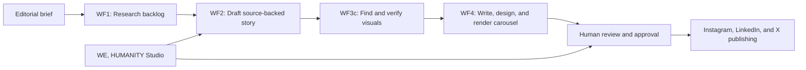

# WE, HUMANITY

WE, HUMANITY is an AI-assisted editorial production system for researching, designing, reviewing, and publishing source-backed social carousels about human creativity, engineering, craft, and information design.

It turns a broad editorial brief into a publishable multi-slide story while keeping the process accountable: research is grounded in named sources, images are checked against licence rules, AI-generated visuals are labelled, and a human approval step is required before publication.

## The problem it solves

High-quality editorial social content normally involves several manual jobs: choosing a worthwhile subject, researching it, verifying claims, finding legally usable imagery, writing platform-specific copy, designing slides, and coordinating approval and publishing.

WE, HUMANITY organizes those jobs into a connected workflow. It gives a small editorial team a reusable production system rather than a one-off content generator.

## How the workflows connect



## Workflow details

### WF1 — Research backlog

**Purpose:** Finds a small set of potential stories that fit the series: real objects, structures, instruments, or information-design systems shaped by a concrete human constraint.

**How it works:** It checks existing Airtable story titles to avoid duplicates, asks the research model for documented candidates across the rotating editorial themes, and places the strongest candidates into a backlog for later drafting.

**Output:** A queue of researchable subjects with enough factual grounding to begin the story workflow.

### WF2 — Draft story

**Purpose:** Turns a selected backlog subject into a source-backed editorial story.

**How it works:** It creates four narrative layers: **Glance** for the hook, **Explore** for the problem, **Deep Dive** for the mechanism or decision, and **Remember** for the enduring design lesson. It writes the story to Airtable with source context and flags claims that need editorial attention.

**Guardrail:** The workflow does not automatically approve a story. Any dates, quantities, quotations, or strong historical claims are surfaced for human review.

### WF3c — Image research and asset verification

**Purpose:** Finds visuals that accurately represent each part of the story and can be used legally.

**How it works:** It plans 4–7 slide-specific image subjects, searches Wikimedia Commons first, then Openverse, and applies deterministic checks to each candidate. It accepts only public-domain, CC0, CC BY, or CC BY-SA imagery with source-page and resolution requirements. When no valid source image exists, it can request a documentary-style AI visual and labels it as AI-generated.

**Output:** Selected assets with source URLs, licence data, attributions, confidence, and review status. Failed downloads and unresolved image matches are recorded for follow-up rather than silently passing through.

### WF4 — Carousel production and publishing

**Purpose:** Converts an approved story and its verified assets into platform-ready social content.

**How it works:** It polishes carousel and caption copy, selects a slide layout and typography treatment, renders 4–7 `1080 × 1350` SVG slides, converts them to PNGs through the local render service, and prepares captions for Instagram, LinkedIn, and X. The Studio supports previews, reruns, downloads, and publication controls.

**Guardrail:** Publication remains behind a human approval step. Publishing status is recorded so retries do not duplicate posts when one platform succeeds and another fails.

## Why this is more than content generation

The system connects models to bounded tools and stateful business data:

| Concern | How it is handled |
| --- | --- |
| Research quality | Subject-specific prompts, source requirements, validation flags, and review gates |
| Asset rights | Deterministic licence and metadata filters before an image can proceed |
| Operational state | Airtable records track briefs, stories, assets, review status, and publishing outcomes |
| Tool use | n8n workflows call research, image, rendering, storage, and publishing services in sequence |
| Human control | Workflows do not automatically approve stories; publication requires explicit review |
| Failure handling | Image failures and publishing status are recorded so runs can be reviewed or resumed safely |

## Technology

- **Orchestration:** n8n workflows (`WF1`, `WF2`, `WF3c`, and `WF4`)
- **AI models:** Gemini, OpenAI, Anthropic, and other configured providers through n8n
- **Editorial database:** Airtable
- **Studio:** Node.js local web application
- **Rendering:** SVG generation plus a headless-Chrome PNG render service
- **Publishing:** Instagram Graph API, with architecture for LinkedIn and X distribution
- **Image sources:** Wikimedia Commons, Openverse, and labelled AI-generated fallback imagery

## Repository guide

| Path | Purpose |
| --- | --- |
| [app/](app) | Local WE, HUMANITY Studio server and browser interface |
| [n8n/](n8n) | Sanitized workflow exports and import instructions |
| [scripts/](scripts) | Carousel rendering, PNG conversion, and Instagram publishing helpers |
| [licence-filter.js](licence-filter.js) | Deterministic Wikimedia Commons licence and image-metadata filtering |
| [docs/WE-HUMANITY.md](docs/WE-HUMANITY.md) | Editorial rules, architecture, and workflow responsibilities |
| [docs/fallback-architecture.md](docs/fallback-architecture.md) | Image-source fallback and licensing strategy |
| [docs/downstream-publishing-architecture.md](docs/downstream-publishing-architecture.md) | Social publishing and failure-handling architecture |

## Run locally

### Prerequisites

- Node.js 20 or later
- n8n instance for imported workflows
- Google Chrome for SVG-to-PNG rendering, or `CHROME_BIN` set to a compatible browser binary
- Credentials and accounts for the services you choose to enable

### Start the local tools

```bash
# Set the root used by imported n8n workflow paths.
export WE_HUMANITY_ROOT="$PWD"

# Start the SVG-to-PNG render service on http://127.0.0.1:5690
npm run render-server

# In another terminal, start the Studio on http://127.0.0.1:5695
npm run studio

# Run the deterministic licence and workflow guard checks
npm test
```

## Import n8n workflows

The workflow exports are deliberately sanitized for this public repository. They omit credentials, account metadata, workflow IDs, active state, and local-machine paths.

1. Import each workflow in [n8n/](n8n).
2. Reconnect credentials in your n8n instance.
3. Set `WE_HUMANITY_ROOT` to the repository’s absolute path in n8n’s environment.
4. Replace the Airtable placeholder identifiers with your own workspace resources.
5. Test every external integration before activating or publishing.

See [n8n/README.md](n8n/README.md) for the full import checklist.

## Status and boundaries

This repository is a shareable portfolio version of the project. It contains the orchestration logic, Studio code, rendering helpers, documentation, and sanitized workflow exports. It intentionally excludes credentials, local renders, operational data, and account-specific workflow metadata.

No licence has been specified. Treat the source as proprietary unless the repository owner adds one.
