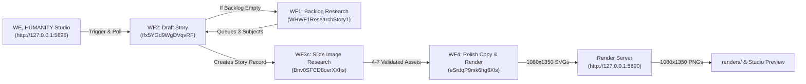

# WE, HUMANITY — Editorial Bible & System Architecture

**WE, HUMANITY** is an independent editorial series and automated publishing studio celebrating human creativity, discovery, craftsmanship, and design—across both **physical artifacts and digital/information systems**.

Rather than abstract theory or generic history summaries, every **WE, HUMANITY** story is **artifact- and constraint-led**: it anchors on a **specific, real, documented object, vessel, structure, instrument, interface, or information-design breakthrough**—showing the hard human constraint that forced its creation, the exact mechanism or interface decision that solved it, and why that design principle still shapes how we build today.

---

## 1. Core Identity & Editorial Philosophy

- **Mission:** Remind people what human hands and minds are capable of designing when solving hard real-world constraints—from ancient engineering to iconic digital interfaces.
- **Core Audience:** Curious builders, designers, engineers, and general readers who appreciate deep, concrete explanations written in plain everyday language (zero academic jargon).
- **Primary Airtable Pillar:** **`Form and function`** — where material or visual mastery, geometry, and practical necessity meet.
- **Four Rotating Sub-Themes (Ancient to Modern):**
  1. **Physical Craft & Vessels:** Tools, hulls, everyday objects, and industrial design classics (e.g., *The Gokstad & Oseberg Viking Ships*, *Bialetti Moka Express*, *Dieter Rams's Braun T3 Pocket Radio*).
  2. **Architecture & Infrastructure:** Survival engineering, water systems, bridges, and passive climate structures (e.g., *The Persian Qanat*, *Roman Pozzolana Concrete*, *Iranian Windcatchers*).
  3. **Scientific Instruments & Mapping:** Navigation, timekeeping, cartography, and precision measurement (e.g., *John Harrison's H4 Marine Chronometer*, *The Dunhuang Star Chart*, *Polynesian Stick Charts*).
  4. **Digital Interfaces & Information Design:** Iconic user interfaces, typography, wayfinding systems, and computing design breakthroughs (e.g., *Xerox Alto & the Desktop Metaphor*, *Susan Kare's Macintosh Iconography*, *Massimo Vignelli's NYC Subway Map*, *Margaret Hamilton's Apollo AGC Priority Display*).
- **Narrative Arc (Constraint → Mechanism → Timeless Takeaway):**
  1. **Start with the hard constraint:** What environment, physical limit, or cognitive bottleneck caused conventional approaches to fail?
  2. **Break down the mechanism or interface decision:** What exact joint, material, layout, symbol, or feedback loop solved it?
  3. **Close with a timeless design takeaway:** Why does that underlying principle still govern how we design products, tools, or interfaces today?
- **Voice & Tone:**
  - **Reverent, never stuffy:** Respects the maker's craft without sounding like a textbook or academic paper.
  - **Concrete over superlative:** Replaces vague praise (*"revolutionary"*, *"game-changing"*) with tangible stakes, materials, measurements, and mechanisms (*"an oil lamp kept the tunnel straight"*, *"overlapping oak strakes lashed to flexible ribs"*, *"a 32×32 pixel grid forced every icon to read like a road sign"*).
  - **Plain everyday language:** Uses clear, physical words (*"twisting"*, *"wave force"*, *"flexible joints"*) instead of academic/engineering jargon (*"torsion"*, *"kinetic energy"*, *"decoupled structure"*).

---

## 2. The Four-Depth Story Structure

Every story drafted in Airtable (`Stories` table) is written at four progressive depths so the same research powers both long-form reading and short-form social carousels:

| Depth | Purpose | Length |
| :--- | :--- | :--- |
| **1. Glance** | Captures the hook, the hard constraint, and the central feat at a glance. | 1–2 punchy sentences |
| **2. Explore** | Explains the environment, the problem, and why conventional approaches failed. | 2 short paragraphs |
| **3. Deep Dive** | Details the maker, the physical mechanism or interface decision, the turning point, and the proof/test. | 2–3 short paragraphs |
| **4. Remember** | Distills the timeless design or human principle that still shapes how we build today. | 1–2 sentences |

---

## 3. Carousel Design & Editorial Rules (4–7 Slides)

When a story is adapted into a `1080×1350` (4:5 portrait) carousel for Instagram, LinkedIn, and X:

### Slide Count & Pacing
- **4 to 7 slides per story:** The slide count adapts to the story's distinct visual beats—never padded with filler slides just to hit a fixed number.
- **One idea per slide:** Each slide carries one complete thought in **28 to 35 words** (`22 to 30 words` on the final slide). Sentences never cut off mid-thought with ellipses (`...`).

### Slide-by-Slide Anatomy
1. **Slide 1 — Scroll-Stopping Cover:**
   - **Headline (`64px` bold):** A concrete, intriguing 7–12 word hook (e.g., *"Persians moved water 70 km underground with **no pumps**."*) rather than a dry label.
   - **Subtitle (`29px`):** One crisp sentence (10–16 words) with **no parentheses**.
   - **Visual:** A bright, iconic, immediately recognizable museum artifact, architectural opening, vintage hardware/interface specimen, or historical subject—never a dark, muddy texture.
   - **Swipe Cue:** A pill badge (`Swipe →`) in the bottom-right corner.
2. **Slides 2 to N−1 — Value-Driven Body Slides:**
   - **Headline (`48px` bold):** A 4–8 word payoff or insight (e.g., *"The desert sun couldn't steal a drop."*, *"An **oil lamp** kept the tunnel straight."*). Structural labels like *"The Hook"*, *"The Problem"*, *"Why It Mattered"*, or *"The Breakthrough"* are banned.
   - **Body (`31px`):** 28–35 plain-language words over a darkened editorial gradient scrim (`editorialScrim`) for effortless mobile readability.
   - **Standout Detail:** Surfaces the single most surprising physical or interface detail (a tool, measurement, pixel grid constraint, or clever trick) on its own dedicated slide.
3. **Final Slide (Slide N) — Legacy & Single-Question Pill CTA:**
   - Carries the core **Remember** takeaway (22–30 words).
   - Ends with **one short question** (4–6 words, e.g., *"Which ancient innovation next?"*) rendered inside its own separate translucent pill button—never combined with body text or highlighted in yellow.

### Highlighting Discipline
- **Maximum 1 to 3 words per slide:** At most one short phrase (1–3 words) per slide is highlighted in warm gold (`#F5B841` on photo slides, `#1D4ED8` on card slides).
- Enforced both in the editorial prompt and deterministically in code (`highlightBudget = { remaining: 3 }` per slide).

### Captions
- **Instagram:** Opens with a keyword-rich first-line hook, followed by 2 short plain-language paragraphs, a question prompt, and **3 to 5 relevant hashtags**.
- **LinkedIn:** Keyword-rich opening line, concise narrative summary, and full per-slide image attributions.
- **X Thread:** 2-post punchy summary thread.

---

## 4. Strict Factual Accuracy & Human Review Guardrails

1. **Source-Backed Facts Only:** Workflows only state facts present in the researched brief and cited sources.
2. **Named Attribution for Figures:** Every specific number (draft, date, dimension, distance, resolution) must name the exact vessel, artifact, system, or site it belongs to (e.g., *"The Gokstad ship drew just 85 cm of water"*).
3. **Measured Comparisons:** Sweeping claims about outside groups (e.g., *"continental shipbuilders"*) are avoided unless directly sourced; comparisons use hedges like *"likely"* or *"researchers suggest"*.
4. **Cross-Slide Technical Consistency:** Technical descriptions remain consistent across all slides (e.g., never claiming planks were *"not bolted"* on one slide while showing iron clinker rivets on another).
5. **Automatic Review Flags:**
   - Stories containing dates/numbers, direct quotes, or attribution claims (`invented`, `first`, `pioneered`) are automatically flagged in Airtable (`Flags`) with `Status = needs_review`.
   - Workflows **never** set `Status = Approved` automatically—human approval remains a strict manual gate.

---

## 5. Three-Tier Image Research & Licensing (`WF3c`)

Every carousel slide is paired with a verified visual asset stored in Airtable (`Assets` table) and local `assets/`:

1. **Tier 1 — Wikimedia Commons (Archival, Museum & Specimen First):**
   - Queries Wikimedia Commons API for each slide's real subject.
   - **Physical & Digital Visuals:** Targets museum photographs and architectural views for physical stories, and vintage hardware/CRT displays, original UI specimens, typography sheets, or patent/blueprint diagrams when the story is about digital or information design.
   - **Deterministic Filter (`licence-filter.js`):** Accepts only `Public domain`, `CC0`, `CC BY`, and `CC BY-SA` (rejects `NC`, `ND`, unfree licenses, low-res images, and extreme aspect ratios).
   - **Cover & Final Slide Priority:** Strongly prefers real museum/archival photographs whenever a valid candidate depicts the story's primary artifact, hardware, or site.
2. **Tier 2 — Openverse Fallback:**
   - If Wikimedia Commons yields no passing candidate for a slide, queries the Openverse API under the same license and resolution guards.
3. **Tier 3 — Documentary AI Synthesis (`models/gemini-2.5-flash-image`):**
   - Used only when neither Wikimedia Commons nor Openverse has a valid archival photograph.
   - Prompts for a **bright, well-lit archival museum documentary photograph** (or tactile mid-tone hardware/studio macro scene) with even studio/daylight fill and lifted shadow detail so dark gradients never obscure the subject.
   - Explicitly recorded in Airtable with `AI Generated = true` for internal provenance and omitted from the rendered slide footer.

---

## 6. End-to-End System Architecture

| Component | Path / ID | Responsibility |
| :--- | :--- | :--- |
| **WF1 — Backlog Research** | [n8n/WF1-research-story-backlog.json](file:///Users/admin/Documents/My%20Workspace/we-humanity-wf3c/n8n/WF1-research-story-backlog.json) (`WHWF1ResearchStory1`) | Checks existing Airtable story titles to prevent duplicates, researches 3 documented subjects across the 4 rotating sub-themes via Gemini (`models/gemini-3.8-flash` + Google Search), and queues the top candidate in `Backlog`. |
| **WF2 — Draft Story** | [n8n/WF2-draft-story.json](file:///Users/admin/Documents/My%20Workspace/we-humanity-wf3c/n8n/WF2-draft-story.json) (`Ifx5YGd9WgDVqvRF`) | Pulls the next queued backlog item (or triggers `WF1`), drafts `Glance`, `Explore`, `Deep Dive`, `Remember`, and `Sources` under strict accuracy and plain-language rules, saves the `Stories` record, and triggers `WF3c`. |
| **WF3c — Image Research** | [n8n/WF3c-research-slide-images.json](file:///Users/admin/Documents/My%20Workspace/we-humanity-wf3c/n8n/WF3c-research-slide-images.json) (`Bnv0SFCD8oerXXhs`) | Plans 4–7 visual slides, searches Wikimedia Commons → Openverse → Gemini Flash Image fallback, verifies/downloads binaries to `assets/`, creates linked `Assets` records in Airtable, and triggers `WF4`. |
| **WF4 — Render & Publish** | [n8n/WF4-social-carousel-publish.json](file:///Users/admin/Documents/My%20Workspace/we-humanity-wf3c/n8n/WF4-social-carousel-publish.json) (`eSrdqP9mk6hg6Xls`) | Polishes slide copy (scroll-stopping cover, 28–35 word plain-language body, ≤3 highlighted words, single-question pill CTA, keyword-rich captions), renders `1080×1350` SVGs and PNGs via `render-server.js`, and saves outputs to `renders/`. |
| **Render Server** | [scripts/render-server.js](file:///Users/admin/Documents/My%20Workspace/we-humanity-wf3c/scripts/render-server.js) (`127.0.0.1:5690`) | Local headless Chrome microservice converting `1080×1350` SVGs with embedded base64 photography into crisp `1080×1350` PNGs. |
| **WE, HUMANITY Studio** | [app/server.js](file:///Users/admin/Documents/My%20Workspace/we-humanity-wf3c/app/server.js) (`127.0.0.1:5695`) | Web studio to trigger the pipeline, watch live per-stage progress (`WF1` → `WF2` → `WF3c` → `WF4`), preview Instagram/LinkedIn/X carousels in full screen, copy captions, and download rendered PNGs. |
